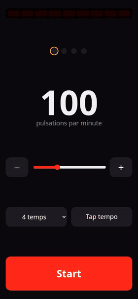

# Mon tempo

A metronome that runs in the browser, on a phone or a computer: time
signature (1 to 12 beats), tempo (30 to 250 BPM), accented first beat, tap
tempo and a K2000-style scanner light. No install, no account, no store.

**[Open the app](https://nicokosi.github.io/mon-tempo/)**

Settings live in the URL (`?bpm=96&beats=3`), so a bookmark or a home
screen shortcut can hold the settings for one song.

On a computer, the space bar starts and stops the metronome.

## Add it to the iPhone home screen (optional)

Open the link in Safari, then Share → Add to Home Screen.

## Run locally

    python3 -m http.server 8000   # then http://localhost:8000
    node timing.test.mjs          # logic tests

## Publish on GitHub Pages

Settings → Pages → Deploy from a branch → `main`, folder `/ (root)`.
